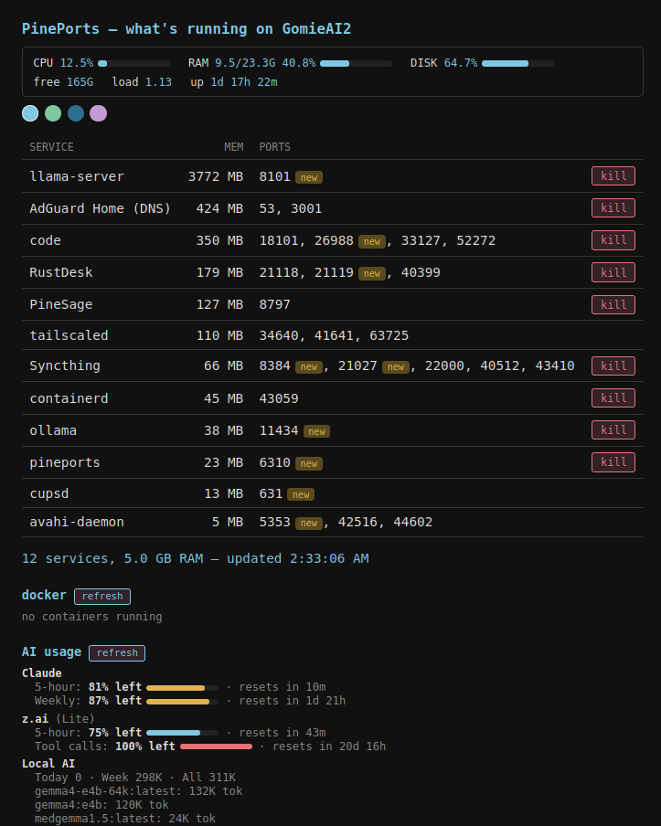

# PinePort

Listener overview for the box it runs on — what's running, on which ports, how much RAM it's eating — plus one-keystroke kills. Runs on **Linux and Windows**. Née `ports`, renamed `pineports`.



## What it does

- `pineports` — CLI table: name, RSS, ports, sorted by memory (one row per pid)
- `pineports kill <port>` — SIGTERM. Docker-published ports stop the container; root-owned pids use passwordless `sudo kill` (sudoers rule `/etc/sudoers.d/ports`: only `/usr/bin/ss -tulpn` and `/usr/bin/kill`, NOPASSWD)
- `pineports --web` — TLS-only web UI on `:6310` (systemd user service `pineports`, enabled)
  - Reachable over the LAN or a private VPN at `https://<hostname>:6310`; the page and login screen show the machine's hostname
  - Ports reachable off-box (TCP, not loopback-bound) are clickable links; hover a service name for its pid + command line
  - Kill buttons hidden for system services (cupsd, avahi, tailscaled, AdGuardHome, systemd)
  - Stats bar: CPU/RAM/disk % with meters, load, uptime — read from `/proc` per poll, no daemons
  - Theme picker: midnight/forest/paper/plum/nord/gruvbox/dracula/solarized/phosphor/amber/contrast, plus four animated themes: Retro (CRT monitor), Departures (split-flap airport board; changed values flip, new ports show BOARDING), Wasteland (rusted riveted plate with falling ash and a flickering generator; new ports glow as SIGNAL) and Tetromino (8-bit Tetris well with a pixel font; each row gets a piece, new services drop in, a stopped one flashes and clears like a line, kill reads DROP, new ports NEXT). Saved in localStorage `pp_theme`
  - Authenticated settings panel: change the dashboard PIN; on Windows, enable or disable hidden launch at sign-in using the same managed shortcut as the desktop settings launcher
  - Add-on system: `_find_addons()` probes PATH at startup (`shutil.which`); found tool → card + `/api/addon/<name>` route, absent → quietly skipped. Contract: CLI prints JSON, supports `--cached` (fast, no network) and bare invocation (live, own cooldowns). Registry in `ADDONS` dict; renderers in `CARD_RENDER` (generic JSON dump fallback). First add-on: [Needle](https://github.com/KGthePM/Needle) (AI usage gauge). Second: `pineports-docker` (real container CPU/RAM via `docker stats --no-stream`). Third: `pineports-gpu` (GPU util %, VRAM used/total, temp, power, fan via `nvidia-smi`; NVIDIA driver required — absent → card skipped).
  - New-listener badge: ports first seen < 24h ago get a `new` badge — labeled ports and ephemeral ports (≥ 32768, VS Code/Firefox) are exempt. History in `~/.config/pineports-seen.json`.

## Install

PinePort requires **Python 3.11+**. Python 3.13 or newer is recommended.

```bash
git clone https://github.com/KGthePM/PinePort.git && cd PinePort && ./install.sh
```

The installer creates a private Python environment under
`~/.local/share/pineports/`, installs the required
[`cryptography`](https://pypi.org/project/cryptography/) package, copies
`pineports`, `pineports-docker`, `pineports-gpu` and the `ports` alias to
`~/.local/bin`, and asks for a four-digit dashboard PIN. The PIN is stored as a
salted, memory-hard Argon2id record readable only by your user. The installer
also enables the `pineports` systemd user service with linger, so the dashboard
starts at boot and keeps running while you're logged out.

```bash
./install.sh               # re-run any time to update; keeps your PIN and labels
./install.sh --reset-pin   # choose a new PIN
./install.sh --uninstall   # remove it (asks before deleting config or turning off linger)
pineports-uninstall        # same, from anywhere (no repo clone needed)
```

Optional: `~/.local/share/pineports/venv/bin/python -m pip install setproctitle`
(nicer process name).

## HTTPS and the local CA

Port 6310 accepts **HTTPS only**. Plaintext `http://...:6310` connections fail;
PinePort does not keep a second plaintext port open for redirects. On first web
startup, PinePort creates a persistent local certificate authority (CA) and a
one-year server certificate. The server certificate covers `localhost`, the
machine hostname, loopback, and local IP addresses detected at startup. It is
renewed automatically while the same CA is retained.

Open one of these addresses:

```text
https://localhost:6310
https://<machine-hostname>:6310
https://<LAN-or-VPN-IP>:6310
```

A browser initially warns that the local CA is not trusted. You may proceed
through that warning, or install the **public** CA certificate on a client to
get an identity-verified connection without warnings. The easiest way is to
open this address in the client's browser and download the file:

```text
https://<host>:6310/ca.crt
```

Before the CA is trusted, the client browser warns about that address too;
proceeding through the warning once is enough to download the file. The same
file lives on the host at:

- Linux host: `~/.config/pineports-ca.crt`
- Windows host: `%APPDATA%\pineports\pineports-ca.crt`

Copy only `pineports-ca.crt` to computers or phones. Never copy
`pineports-ca.key` or `pineports-tls.key`; those private keys must remain on the
PinePort host. Trust-store steps vary by browser and mobile OS:

- **iPhone/iPad (Safari):** open the downloaded `.crt` (or AirDrop/email it),
  install the profile iOS offers, then turn on full trust under
  Settings → General → About → **Certificate Trust Settings**. Installing the
  profile alone is not enough, and Safari can look completely fine without the
  toggle — it may never warn again after one bypass — yet "Add to Home Screen"
  still saves a blank tile instead of the app icon. After enabling the toggle,
  delete any home-screen tile added earlier and add it again.
- **Windows:** the current user can trust the CA with:

```powershell
certutil -user -addstore Root "$env:APPDATA\pineports\pineports-ca.crt"
```

If the host gains a new address, restart PinePort so it can add that address to
the server certificate. Extra DNS names or IP addresses can be supplied as a
comma-separated `PINEPORT_TLS_NAMES` environment variable. Deleting the CA
files creates a new browser identity and requires clients to trust the new CA.

Optional sudoers rule for killing root-owned pids (deliberately narrow):

```
kg ALL=(root) NOPASSWD: /usr/bin/ss -tulpn, /usr/bin/kill
```

## Windows

Same tool, same web UI, same CLI. Requires **Python 3.11+**; data comes from
built-in PowerShell (`Get-NetTCPConnection`) plus [psutil](https://pypi.org/project/psutil/)
for process names/RAM and the stats bar:

```powershell
git clone https://github.com/KGthePM/PinePort.git; cd PinePort
python -m pip install --upgrade -r requirements.txt
.\open-pineports.cmd       # start if needed, then open the dashboard
.\start-pineports.cmd      # start in the background without opening a browser
.\restart-pineports.cmd    # reload PinePort and newly installed add-ons in the background
.\stop-pineports.cmd
.\settings-pineports.cmd   # automatic startup and dashboard PIN settings
.\test-pineports.cmd       # cross-platform + real-Windows test suites
```

- The CMD launchers are double-clickable. Their shared PowerShell implementation
  is `windows\pineports.ps1`. Runtime PID and logs are stored under
  `%APPDATA%\pineports\`. If several Python installations are available, the
  launcher selects a Python 3.11+ installation with `psutil` and
  `cryptography>=50.0.2`; if none has both, the launcher prints the exact
  install command.
- Manual commands remain available: `python pineports`,
  `python pineports --set-pin`, `python pineports kill <port>`, and
  `python pineports --web`.
- **Settings and startup:** use the dashboard's **settings** panel or open
  `settings-pineports.cmd` to change the dashboard PIN and enable or disable
  launch at Windows sign-in. PinePort creates a current-user Startup-folder
  shortcut and starts hidden without opening a browser; no administrator
  access is needed. The dashboard requires the current PIN before changing it.
- **Full-kill parity:** your own processes die with one click. Killing another
  user's process needs an elevated console (`Run as administrator`) — the UI
  tells you when that's the case.
- **Docker Desktop:** published ports stop the container, same as Linux.
- **Config:** `%APPDATA%\pineports\` — same filenames as Linux
  (`pineports-pin`, `pineports-labels.conf`, `pineports-seen.json`) plus the
  local CA and server certificate/key files.
- **No psutil?** A manual launch still lists ports + pids; install psutil for
  names, RAM, kills, and the stats bar.
- **AI usage:** install [Needle](https://github.com/KGthePM/Needle). PinePort
  discovers `needle` on PATH and the standard
  `%LOCALAPPDATA%\Needle\bin\needle.py` installation. Restart PinePort after
  installing Needle so the AI usage card is registered.
- **GPU readings:** `pineports-gpu` is installed automatically and shows a
  card when an NVIDIA driver is present (`nvidia-smi` on PATH or in
  System32/NVSMI). GPU util %, VRAM used/total, temp, power, fan. No NVIDIA
  GPU → card is skipped. Restart PinePort if you install the driver later.

### Windows smoke-test checklist (first run on a new machine)

1. `test-pineports.cmd` — all tests pass
2. `python pineports` — table lists listeners with names + RAM
3. `open-pineports.cmd` → log in with your PIN → services + stats bar render
4. Kill a test server you started yourself (the smoke test does this too)
5. Kill a Docker-published port → container stops
6. (Optional, if enabled in settings) sign out and back in → dashboard server is running


## Notes

- Threaded TLS server (`TLSThreadingHTTPServer`) — a slow live add-on call (~seconds) no longer blocks the 5s table poll.
- PIN files use Argon2id (64 MiB, three iterations, a fresh random 16-byte salt). Legacy unsalted SHA-256 files still work and migrate automatically after the next successful login. A four-digit PIN has only 10,000 possibilities, so keep the PIN file/private keys protected and expose PinePort only to networks you trust.
- Sessions are in-memory (restart = re-login), with a 30-day `Secure; HttpOnly; SameSite=Lax` cookie, 1s delay on wrong PIN, and a global 5-minute lockout after 5 wrong PINs. All endpoints are gated, including `/api/services`.
- Friendly port labels live in `~/.config/pineports-labels.conf` (`<port>: <label>`).
- Docker services show tiny RSS (only the ipv4/ipv6 proxy is visible) — `docker stats --no-stream` for real usage.
- `code`/`firefox-bin` entries = VS Code/Firefox on random high ports. Normal.
